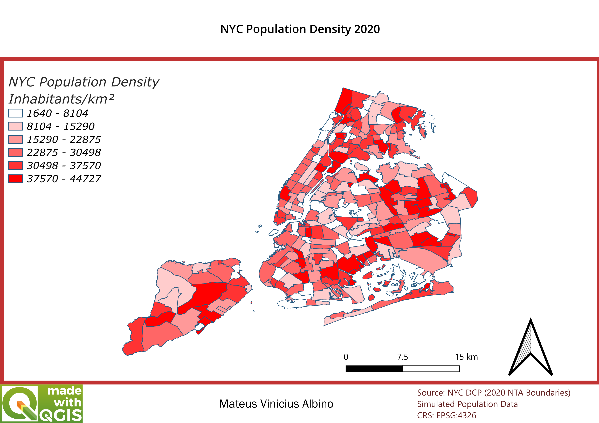

# NYC Population Density by Neighborhood (2020)

This project maps population density across New York City's Neighborhood Tabulation Areas (NTAs). My main goal here was to build a clean choropleth map in QGIS, going from raw spatial boundaries to a final print layout ready for presentation.

## How I built it

* **Boundaries:** I used the official 2020 NTA shapefiles provided by the NYC Department of City Planning (DCP), working under the EPSG:4326 coordinate reference system.
* **Data Modeling:** Since raw census counts weren't attached to this specific geometry layer, I simulated population density values (inhabitants per square kilometer) proportionally to each polygon's area to test the spatial distribution and styling workflow.
* **Classification:** I grouped the data into six classes using the Natural Breaks (Jenks) method. This helps highlight local density clusters instead of flattening the differences between dense areas in Manhattan or Brooklyn and quieter zones in Staten Island.
* **Cartographic Design:** In the QGIS Print Layout, I kept the visual hierarchy simple with a sequential red palette, clear interval labels, a metric scale bar, north arrow, and full metadata in the footer.

## Tools used

* **QGIS** (Attribute calculation, Jenks classification, and Print Layout composition)

## Next steps

I plan to replace the simulated numbers with official 2020 US Census tables using a spatial join, and automate the data cleaning pipeline with Python (GeoPandas) before bringing the layers back into QGIS.
